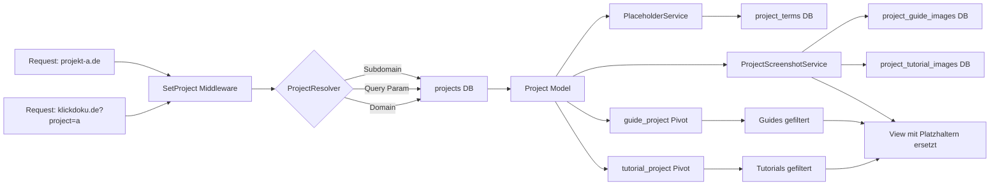

### Execution Plan

✓ Step 1: Datenbank-Grundlage und Modelle
✓ Step 2: Services (PlaceholderService, ProjectResolver, ProjectScreenshotService, TermImportService)
✓ Step 3: Middleware SetProject und Helper
✓ Step 4: Bestehende Modelle und Controller erweitern
✓ Step 5: Admin-Controller und Routes
✓ Step 6: Artisan-Befehle
✓ Step 7: Admin-Views für Projekt-Management (Blade-Templates)
✓ Step 8: Blade-Directive @placeholders() in AppServiceProvider
✓ Step 9: API-Controller mit Projekt-Filter und Platzhalter-Ersetzung erweitern
✓ Step 10: TutorialController mit Projekt-Filter erweitern (analog GuideController)
✓ Step 11: Konzept.md aktualisieren (Kapitel 11: Multi-Projekt-System + Umsetzungsplan)
✓ Step 12: Tests (Unit-Tests für Services, Feature-Tests für Middleware und Controller)
✓ Step 13: Guide- und Tutorial-Resource-Klassen mit Platzhalter-Ersetzung
✓ Step 14: API-Tests mit Projekt-Kontext (11 Tests)
✓ Step 15: Projekt-spezifisches Branding in öffentlichen Views
✓ Step 16: Demo-Projekte mit Beispiel-Guides und -Tutorials befüllen
✓ Step 17: Screenshot-Upload-UI im Admin-Panel

# Anforderungen

## Überblick & Ziele

Aus der bestehenden KlickDoku-Anwendung (einzelne Dokumentations-App) soll ein **zentrales Multi-Projekt-Dokumentationssystem** entstehen, das aus einer einzigen Master-Dokumentation mehrere projektspezifische Dokumentationen bereitstellen kann – dynamisch, ohne separate Installationen.

### Zielgruppen
- **Dokumentations-Verwalter**: Pflegen Master-Inhalte und Projektkonfigurationen im Admin-Panel
- **Projekt-Admins**: Konfigurieren Begriffe, Design und Inhaltsfreigabe für ihr Projekt
- **Endnutzer**: Sehen projektspezifische Dokumentation unter ihrer Domain/Subdomain

### User Stories
1. Als **Dokumentations-Verwalter** möchte ich Master-Anleitungen mit Platzhaltern (z.B. `{{events}}`) schreiben, sodass dieselbe Anleitung für alle Projekte wiederverwendbar ist.
2. Als **Projekt-Admin** möchte ich für mein Projekt eigene Begriffe definieren (z.B. `{{events}}` = "Veranstaltungen" vs. "Termine"), sodass die Dokumentation zur Sprache meines Projekts passt.
3. Als **Endnutzer** möchte ich unter `projekt-a.de` oder `projekt-b.de` automatisch die für mein Projekt angepasste Dokumentation sehen – ohne manuelle Auswahl.
4. Als **Dokumentations-Verwalter** möchte ich pro Anleitung/Tutorial auswählen, welche Projekte diesen Inhalt erhalten, um irrelevante Inhalte auszublenden.
5. Als **Projekt-Admin** möchte ich optional projekt-spezifische Screenshots pro Schritt hinzufügen, um UI-Unterschiede abzubilden.
6. Als **Systemadministrator** möchte ich Projekte über Subdomain (gleicher Server) oder URL-Parameter (unterschiedliche Server) erkennen lassen.

### Funktionalität im Überblick

| Feature | Beschreibung |
|---|---|
| **Platzhalter-System** | `{{app_name}}`, `{{club_name}}`, `{{events}}`, etc. in Titeln, Beschreibungen, Schritten |
| **Projekt-Konfiguration** | DB-gestützte Verwaltung von Projekten mit eigenen Begriffen, Design und Inhaltsfreigabe |
| **Dynamische Multi-Tenant-App** | Eine App, die basierend auf Domain/Subdomain/URL-Parameter automatisch das richtige Projekt anzeigt |
| **Inhaltsfreigabe (Opt-in)** | Explizite Zuweisung: Jeder Guide/Tutorial muss Projekten zugewiesen werden |
| **Screenshot-Fallback** | Master-Screenshot als Standard, projekt-spezifischer Screenshot überschreibt |
| **Begriffsvorschläge** | API-Import aus Hauptprojekten als Vorschlag, manuelle Bestätigung/Überschreibung |
| **Design-Anpassung** | Projekt-spezifische Farben, Logos und Branding |

### Ausgeschlossen vom Scope
- Separate Generierung statischer Dokumentationen (nur dynamischer Modus)
- Vollautomatische Begriffserkennung ohne menschliche Prüfung
- KI-generierte Screenshots
- Separate Installationen pro Projekt

---

### Platzhalter-Katalog (Vorschlag)

| Platzhalter | Beschreibung | Beispiel |
|---|---|---|
| `{{app_name}}` | Name der Anwendung | "Vereinsverwaltung" |
| `{{club_name}}` | Name des Vereins/Clubs | "Sportverein Datteln" |
| `{{member}}` | Singular: Mitglied | "Mitglied" / "Teilnehmer" |
| `{{members}}` | Plural: Mitglieder | "Mitglieder" / "Teilnehmer" |
| `{{event}}` | Singular: Veranstaltung | "Veranstaltung" / "Termin" |
| `{{events}}` | Plural: Veranstaltungen | "Veranstaltungen" / "Termine" |
| `{{news}}` | Nachrichten | "Nachrichten" / "Aktuelles" |
| `{{calendar}}` | Kalender | "Kalender" / "Planer" |
| `{{tutorial}}` | Tutorial | "Tutorial" / "Anleitung" |
| `{{comment}}` | Kommentar | "Kommentar" / "Feedback" |
| `{{board}}` | Vorstand/Brett | "Vorstand" / "Team" |
| `{{team}}` | Team | "Team" / "Mannschaft" |
| `{{guide}}` | Anleitung | "Anleitung" / "Guide" |
| `{{category}}` | Kategorie | "Kategorie" / "Bereich" |
| `{{dashboard}}` | Dashboard | "Dashboard" / "Übersicht" |
| `{{settings}}` | Einstellungen | "Einstellungen" / "Konfiguration" |
| `{{profile}}` | Profil | "Profil" / "Mein Konto" |
| `{{search}}` | Suche | "Suche" / "Finden" |
| `{{help}}` | Hilfe | "Hilfe" / "Support" |
| `{{admin}}` | Admin | "Admin" / "Verwaltung" |

Diese Liste ist erweiterbar – neue Platzhalter können im Admin-Panel hinzugefügt werden.


# Technisches Design

## Aktuelle Implementierung

Die bestehende KlickDoku-App ist ein Laravel 12-Projekt mit:
- **Modelle**: Guide, GuideStep, GuideImage, Tutorial, TutorialStep, TutorialHotspot, ContentTranslation, GuideStepTranslation, Category, Tag, Comment, Rating, Feedback
- **Controller**: GuideController, TutorialController, ApiController, AdminGuideController, etc.
- **Middleware**: SetLocale (Spracherkennung via Route-Parameter), SetCacheHeaders
- **Language Files**: `lang/de/navigation.php`, `lang/de/common.php` (und EN-Pendants)
- **Config**: `config/app.php` mit `supported_locales`, `APP_NAME`
- **Views**: Blade-Templates mit `layouts/public.blade.php` als Hauptlayout
- **Caching**: `CacheHelper` mit Key-Tracking und prefix-basierter Invalidation
- **API**: REST-Endpunkte via `ApiController` mit Resource-Klassen

Das System unterstützt bereits polymorphe Übersetzungen (`ContentTranslation`), was die Grundlage für das Multi-Projekt-Konzept bildet.

---

## Schlüsselentscheidungen

### 1. Virtuelle Multi-Tenant-Architektur
Eine einzige App-Instanz, die basierend auf der eingehenden Anfrage (Subdomain oder URL-Parameter) automatisch das richtige Projekt lädt. Keine separate Generierung, keine statischen Snapshots.

**Projekt-Erkennung:**
- **Subdomain** (gleicher Server): `projekt-a.klickdoku.de` → Middleware erkennt Subdomain
- **URL-Parameter** (unterschiedliche Server): `klickdoku.de?project=projekt-a` → Query-Parameter
- **Fallback**: Kein Projekt → Master-Dokumentation (Standardverhalten)

### 2. Datenbank-gestützte Projektkonfiguration
Alle Projektdaten (Begriffe, Design, Inhaltsfreigabe) werden in der Datenbank gespeichert und über das Admin-Panel verwaltet.

### 3. Platzhalter-Ersetzung via Service-Layer
Ein zentraler `PlaceholderService` übernimmt das Ersetzen von `{{placeholder}}` durch projektspezifische Werte. Der Service wird in Controllern, Views und API-Responses aufgerufen.

### 4. Screenshot-Fallback-Strategie
- Master-Screenshot (`guide_images` / `tutorial_steps.screenshot_path`) ist der Standard
- Projekt-spezifischer Screenshot (`project_guide_images` / `project_tutorial_images`) überschreibt, wenn vorhanden
- Keine Duplizierung: Nur Unterschiede werden gespeichert

### 5. Opt-in Inhaltsfreigabe
Pivot-Tabelle `guide_project` und `tutorial_project` steuern, welche Inhalte für welche Projekte sichtbar sind. Nicht zugewiesene Inhalte erscheinen nicht.

### 6. Begriffsimport via API (Vorschlag)
Optional: Artisan-Befehl importiert Begriffe aus Hauptprojekten (Laravel Language Files oder API-Endpunkt) als Vorschlag. Der User bestätigt/überschreibt im Admin-Panel.

---

## Proposed Changes

### Neue Datenbank-Tabellen

**projects** – Projektkonfiguration
```
projects
  - id
  - name (string, unique) – z.B. "Sportverein Datteln"
  - slug (string, unique) – z.B. "sportverein-datteln"
  - subdomain (string, nullable, unique) – z.B. "projekt-a"
  - domain (string, nullable) – externe Domain, z.B. "projekt-a.de"
  - app_name (string) – z.B. "Vereinsverwaltung"
  - club_name (string) – z.B. "Sportverein Datteln"
  - logo_path (string, nullable) – projektspezifisches Logo
  - primary_color (string, nullable) – z.B. "#1a73e8"
  - secondary_color (string, nullable)
  - is_active (boolean, default true)
  - created_at, updated_at
```

**project_terms** – Platzhalter-Ersetzungen pro Projekt
```
project_terms
  - id
  - project_id (foreign)
  - placeholder_key (string) – z.B. "events", "members", "app_name"
  - value_de (string) – deutsche Übersetzung
  - value_en (string, nullable) – englische Übersetzung
  - created_at, updated_at
  - unique: [project_id, placeholder_key]
```

**guide_project** – Opt-in Zuweisung Guides → Projekte
```
guide_project
  - guide_id (foreign, cascade on delete)
  - project_id (foreign, cascade on delete)
  - primary (boolean, default false) – Master-Zuordnung
  - created_at
  - unique: [guide_id, project_id]
```

**tutorial_project** – Opt-in Zuweisung Tutorials → Projekte
```
tutorial_project
  - tutorial_id (foreign, cascade on delete)
  - project_id (foreign, cascade on delete)
  - primary (boolean, default false)
  - created_at
  - unique: [tutorial_id, project_id]
```

**project_guide_images** – Projekt-spezifische Screenshots für Guide-Schritte
```
project_guide_images
  - id
  - project_id (foreign)
  - guide_step_id (foreign)
  - filename (string)
  - path (string)
  - caption (string, nullable)
  - alt_text (string, nullable)
  - sort_order (integer, default 0)
  - created_at, updated_at
  - unique: [project_id, guide_step_id, sort_order]
```

**project_tutorial_images** – Projekt-spezifische Screenshots für Tutorial-Schritte
```
project_tutorial_images
  - id
  - project_id (foreign)
  - tutorial_step_id (foreign)
  - screenshot_path (string)
  - screenshot_width (integer, nullable)
  - screenshot_height (integer, nullable)
  - created_at, updated_at
  - unique: [project_id, tutorial_step_id]
```

**placeholder_definitions** – Globale Platzhalter-Katalog (Referenz)
```
placeholder_definitions
  - id
  - key (string, unique) – z.B. "events", "members"
  - description_de (text) – Beschreibung des Platzhalters
  - description_en (text, nullable)
  - default_value_de (string) – Standardwert
  - default_value_en (string, nullable)
  - category (string, nullable) – z.B. "navigation", "content", "ui"
  - created_at, updated_at
```

---

### Neue Modelle

```
app/Models/
├── Project.php              – Projektkonfiguration
├── ProjectTerm.php          – Platzhalter-Ersetzung pro Projekt
├── GuideProject.php         – Pivot: Guide ↔ Project
├── TutorialProject.php      – Pivot: Tutorial ↔ Project
├── ProjectGuideImage.php    – Projekt-spezifischer Screenshot (Guide)
├── ProjectTutorialImage.php – Projekt-spezifischer Screenshot (Tutorial)
└── PlaceholderDefinition.php – Globale Platzhalter-Katalog
```

---

### Neue Services

**PlaceholderService** – Zentrale Platzhalter-Ersetzung
```
app/Services/PlaceholderService.php
- resolve(string $text, Project $project): string
- resolveArray(array $data, Project $project): array
- getAllPlaceholders(): array
- getProjectTerms(Project $project): array
```

**ProjectResolver** – Erkennt aktuelles Projekt aus Anfrage
```
app/Services/ProjectResolver.php
- resolveFromRequest(Request $request): ?Project
- resolveFromSubdomain(string $subdomain): ?Project
- resolveFromQueryParam(Request $request): ?Project
- resolveFromDomain(string $domain): ?Project
```

**ProjectScreenshotService** – Liefert korrekten Screenshot (Master oder projekt-spezifisch)
```
app/Services/ProjectScreenshotService.php
- getGuideStepImage(GuideStep $step, ?Project $project): ?GuideImage
- getTutorialStepScreenshot(TutorialStep $step, ?Project $project): string
```

**TermImportService** – Importiert Begriffe aus Hauptprojekten als Vorschlag
```
app/Services/TermImportService.php
- importFromLanguageFiles(string $path): array
- importFromApi(string $url, string $token): array
- suggestTerms(Project $project): array
```

---

### Neue Middleware

**SetProject** – Erkennt und setzt aktuelles Projekt in der Anfrage
```
app/Http/Middleware/SetProject.php
- Reihenfolge: Subdomain → Query-Parameter → Domain → null (Master)
- Speichert Projekt in Request via $request->attributes->set('project', $project)
- Macht Projekt verfügbar via helper: currentProject()
```

---

### Neue Admin-Controller

```
app/Http/Controllers/Admin/
├── AdminProjectController.php       – Projekte CRUD
├── AdminProjectTermController.php   – Begriffe pro Projekt (CRUD + Import)
├── AdminPlaceholderController.php   – Platzhalter-Katalog verwalten
├── AdminProjectContentController.php – Inhaltsfreigabe (Guides/Tutorials → Projekte)
└── AdminProjectImageController.php  – Projekt-spezifische Screenshots
```

---

### Neue Artisan-Befehle

```
app/Console/Commands/
├── ImportTermsCommand.php    – Begriffe aus Hauptprojekt importieren
│   Signature: docs:import-terms {--project=} {--source=}
├── SeedPlaceholdersCommand.php – Platzhalter-Katalog initial befüllen
│   Signature: docs:seed-placeholders
└── VerifyPlaceholdersCommand.php – Unersetzte Platzhalter in Inhalten finden
    Signature: docs:verify-placeholders {--project=}
```

---

### Änderungen an bestehenden Modellen

**Guide.php** – Neue Beziehungen
```php
public function projects() {
    return $this->belongsToMany(Project::class, 'guide_project');
}
public function scopeForProject($query, Project $project) {
    return $query->whereHas('projects', fn($q) => $q->where('projects.id', $project->id));
}
```

**Tutorial.php** – Neue Beziehungen
```php
public function projects() {
    return $this->belongsToMany(Project::class, 'tutorial_project');
}
public function scopeForProject($query, Project $project) {
    return $query->whereHas('projects', fn($q) => $q->where('projects.id', $project->id));
}
```

**GuideStep.php** – Projekt-spezifische Bilder
```php
public function projectImages(Project $project) {
    return ProjectGuideImage::where('guide_step_id', $this->id)
        ->where('project_id', $project->id)
        ->orderBy('sort_order')->get();
}
```

**TutorialStep.php** – Projekt-spezifische Screenshots
```php
public function projectScreenshot(Project $project): ?string {
    $img = ProjectTutorialImage::where('tutorial_step_id', $this->id)
        ->where('project_id', $project->id)->first();
    return $img ? $img->screenshot_path : $this->screenshot_path;
}
```

**Category.php** – Optional: Projekt-spezifische Kategorien
```php
// Kategorien werden aktuell nicht projekt-spezifisch gefiltert
// können später erweitert werden
```

---

### Änderungen an bestehenden Controllern

**GuideController.php** – Projekt-Filter + Platzhalter-Ersetzung
```php
public function index(Request $request) {
    $project = $request->getAttribute('project'); // aus SetProject Middleware
    $query = Guide::with([...])->where('status', 'published');
    if ($project) {
        $query->forProject($project);
    }
    // ... rest unchanged
}

public function show(string $locale, string $slug) {
    $project = request()->getAttribute('project');
    $guide = Guide::where('slug', $slug)->firstOrFail();
    if ($project && !$guide->projects->contains($project)) {
        abort(404);
    }
    // Platzhalter-Ersetzung in View oder via View Composer
}
```

**TutorialController.php** – Analog zu GuideController

**ApiController.php** – Projekt-Filter + Platzhalter in JSON-Responses
```php
public function guides(Request $request) {
    $project = $request->getAttribute('project');
    $query = Guide::with([...])->where('status', 'published');
    if ($project) {
        $query->forProject($project);
    }
    // ... 
}
```

---

### Änderungen an Views

**layouts/public.blade.php** – Projekt-spezifisches Branding
```blade
<title>@yield('title', currentProject() ? currentProject()->app_name : config('app.name'))</title>
<!-- Logo -->
logo_url : asset('logo.png') }}">
<!-- Farben -->
<style>
  :root {
    --primary: {{ currentProject() ? currentProject()->primary_color : '#1a73e8' }};
  }
</style>
```

**Blade Directive für Platzhalter**
```php
// app/Providers/AppServiceProvider.php
Blade::directive('placeholders', function ($expression) {
    return "<?php echo \\App\\Services\\PlaceholderService::resolve({$expression}, \\App\\Services\\ProjectResolver::current()); ?>";
});
```

Nutzung in Views:
```blade
@placeholders($guide->title)
@placeholders($step->description)
```

---

### Architektur-Diagramm



---

### Risken & Edge Cases

| Risiko | Beschreibung | Minderung |
|---|---|---|
| **Unersetzte Platzhalter** | Platzhalter in Inhalten werden nicht ersetzt, weil kein Term existiert | `docs:verify-placeholders` Command + Fallback auf Platzhalter-Text |
| **Performance bei vielen Projekten** | Jede Anfrage lädt Projekt + Terms + Screenshots | Caching via CacheHelper mit projekt-spezifischen Keys |
| **Cache-Kollisionen** | Master- und Projekt-Cache überschneiden sich | Cache-Keys enthalten Projekt-Slug als Prefix |
| **Screenshot-Fallback-Komplexität** | Logik für Master vs. projekt-spezifisch ist komplex | Zentrale `ProjectScreenshotService` kapselt die Logik |
| **Inhaltsfreigabe-Vergessen** | Neue Guides werden keinem Projekt zugewiesen | Admin-Panel zeigt Warnung bei unzugewiesenen Guides |
| **Subdomain-Konflikte** | www, api, admin kollidieren mit Projekt-Subdomains | Reservierte Subdomains in Config whitelist/blacklist |


# Testing

## Validierungsansatz

Das Multi-Projekt-System wird schrittweise validiert, wobei jeder Stage eigenständig testbar ist.

### Key Scenarios

1. **Projekt-Erkennung via Subdomain**
   - Request an `projekt-a.klickdoku.de` → SetProject Middleware erkennt Projekt A
   - Request an `klickdoku.de` → Kein Projekt, Master-Dokumentation
   - Request an `unbekannt.klickdoku.de` → Fallback zu Master

2. **Platzhalter-Ersetzung**
   - Guide-Titel "Willkommen bei {{app_name}}" → "Willkommen bei Vereinsverwaltung" (Projekt A)
   - Guide-Titel "Willkommen bei {{app_name}}" → "Willkommen bei RegattaPortal" (Projekt B)
   - Unbekannter Platzhalter `{{xyz}}` → bleibt als `{{xyz}}` erhalten (Fallback)

3. **Inhaltsfreigabe (Opt-in)**
   - Guide "Login" ist Projekt A und B zugewiesen → erscheint in beiden
   - Guide "Regatta-Setup" ist nur Projekt C zugewiesen → erscheint nur in Projekt C
   - Guide ohne Projekt-Zuweisung → erscheint nur in Master-Doku

4. **Screenshot-Fallback**
   - GuideStep hat Master-Screenshot, kein projekt-spezifischer → Master wird angezeigt
   - GuideStep hat Master-Screenshot + projekt-spezifischer → projekt-spezifischer wird angezeigt
   - GuideStep hat keinen Master-Screenshot, aber projekt-spezifischer → projekt-spezifischer wird angezeigt

5. **API-Responses**
   - GET `/api/guides` mit Projekt-Header → nur zugewiesene Guides, mit Platzhaltern ersetzt
   - GET `/api/guides` ohne Projekt → alle Guides, ohne Ersetzung

### Edge Cases

- **Leeres Projekt**: Projekt existiert, hat aber keine Terms → alle Platzhalter bleiben unverändert
- **Projekt ohne Inhalte**: Projekt existiert, hat keine Guides/Tutorials zugewiesen → leere Liste
- **Gleichzeitige Änderungen**: Cache wird bei Änderungen an Projekt-Terms invalidiert
- **Reservierte Subdomains**: `www`, `api`, `admin` werden nicht als Projekt interpretiert
- **Sprachwechsel + Projektwechsel**: Kombination aus Locale-Middleware und Project-Middleware funktioniert korrekt

### Test-Changes

- Feature-Tests für SetProject Middleware (Subdomain, Query-Param, Domain)
- Unit-Tests für PlaceholderService (Ersetzung, Fallback, Array-Verarbeitung)
- Feature-Tests für GuideController mit Projekt-Filter
- Feature-Tests für Screenshot-Fallback-Logik
- Tests für API-Endpunkte mit Projekt-Kontext
